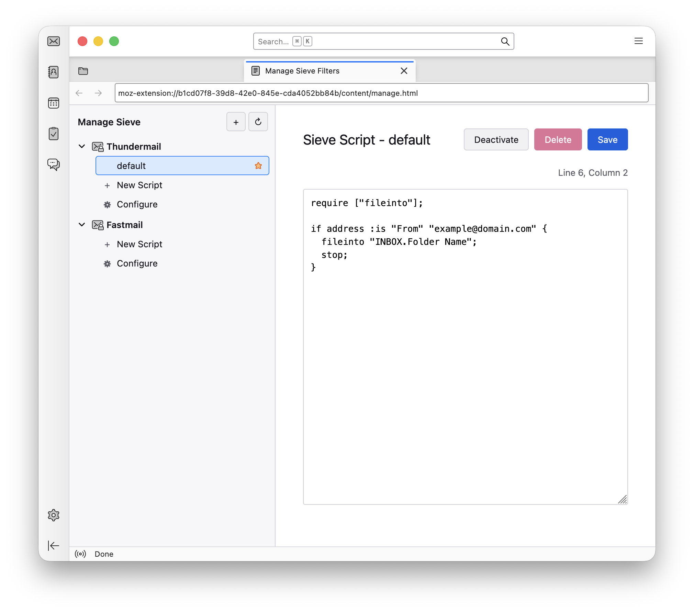

# Manage Sieve Filters

Manage Sieve Filters is a Thunderbird extension for managing server-side mail
filters written as Sieve scripts. It connects to Sieve-capable servers using
JMAP Sieve over HTTPS, then lists, edits, validates, saves, creates, deletes,
activates, and deactivates scripts from Thunderbird.



## Development

Some useful commands:

```
# The usual npm dance
npm install
npm test
npm run lint
npm run build

# Test in a live Thunderbird using web-ext
cd src
web-ext -f /path/to/thunderbird run 
```
